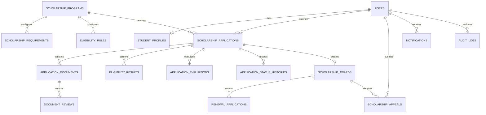

# Database documentation

The local runtime database is MariaDB/MySQL supplied by XAMPP. Laravel migrations in `database/migrations` are the schema source of truth.

## Relationship diagram

## Core data dictionary

| Table | Purpose | Important constraints |
|---|---|---|
| `users` | Accounts and RBAC role/status | Unique email; role is `admin`, `staff`, or `student` |
| `student_profiles` | Student identity, academic, and contact data | One profile per user; unique student number |
| `scholarship_programs` | Program catalogue and application window | Unique program code; status lifecycle |
| `scholarship_requirements` | Per-program upload rules | Allowed extensions and max size are configurable |
| `eligibility_rules` | Configurable screening criteria | Rules can target profile/application/template fields with numeric, text, date, boolean, list, and document comparisons; failures can be disqualifying or sent to manual review |
| `scholarship_applications` | Draft/submitted application snapshot | Application number unique; status changes are server controlled |
| `application_documents` | Private uploaded files and verification state | File path is private; ownership is checked on every access |
| `eligibility_results` | Screening result and reasons | Append-only screening records |
| `application_evaluations` | Staff score, notes, recommendation | Evaluator is recorded |
| `application_status_histories` | Status timeline | Previous/new status, actor, time, and remarks |
| `scholarship_awards` | Award created after approval, with current membership status and reason | One award per approved application; status version prevents stale appeal decisions |
| `scholarship_appeals` | Student reinstatement requests and administrator responses | Unique appeal number; at most one pending appeal per award via unique `(scholarship_award_id, pending_slot)`; finalized rows use NULL for the slot |
| `renewal_applications` | Scholar renewal workflow | Student and deciding admin are recorded |
| `notifications` | In-app messages | User scoped and read timestamps |
| `announcements` | Published system notices | Audience scoped |
| `audit_logs` | Sensitive/admin activity trail | Actor, action, entity, old/new values, and request metadata |

## Environment variables

The complete column, index, and foreign-key inventory is in [data-dictionary.md](data-dictionary.md). Regenerate it with `php tools/export-schema.php`. Schema metadata includes the `document_reviews` append-only review model, soft-deleted document replacements, unique application cycles, unique renewal cycles, sessions, queues, cache and Sanctum tokens.

Additional feature settings: `APP_TIMEZONE=Asia/Manila`, `REQUIRE_EMAIL_VERIFICATION`, `EMAIL_NOTIFICATIONS`, `SANCTUM_EXPIRATION` (minutes), `SESSION_SECURE_COOKIE`, `DOCUMENT_STORAGE=local|supabase`, `MAX_UPLOAD_KB`, `SUPABASE_URL`, `SUPABASE_SERVICE_ROLE_KEY`, `SUPABASE_STORAGE_BUCKET` and `MAIL_SCHEME`. Defaults are in `.env.example`; deployment details are in [installation.md](installation.md).

Required local values are in `.env.example`: `APP_KEY`, `APP_URL`, `DB_CONNECTION=mysql`, `DB_HOST`, `DB_PORT`, `DB_DATABASE`, `DB_USERNAME`, `DB_PASSWORD`, `SESSION_DRIVER`, `FILESYSTEM_DISK`, `QUEUE_CONNECTION`, and `MAIL_*`. Never commit `.env` or credentials.

`SHOW_DEMO_CREDENTIALS` defaults to `false`; when enabled it displays fictional seeded login hints in the local environment only. Never enable it for a real student installation.
